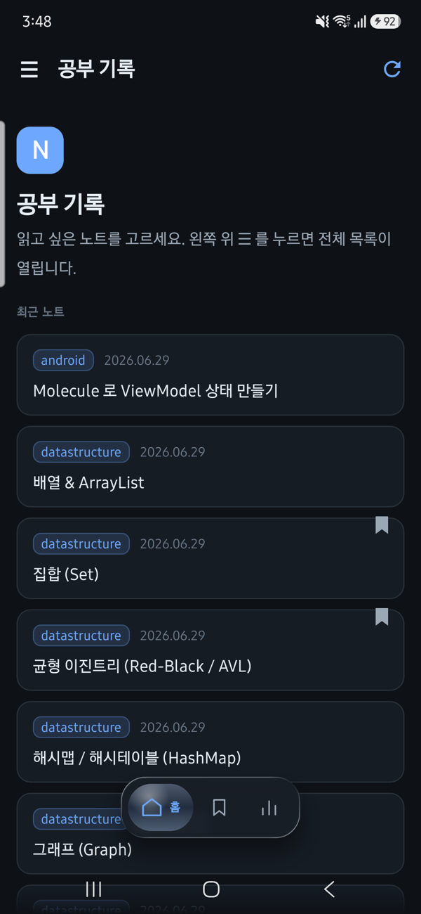
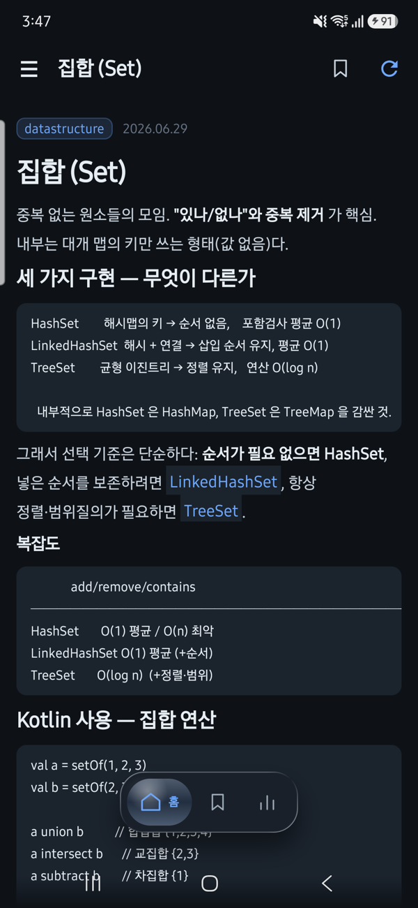
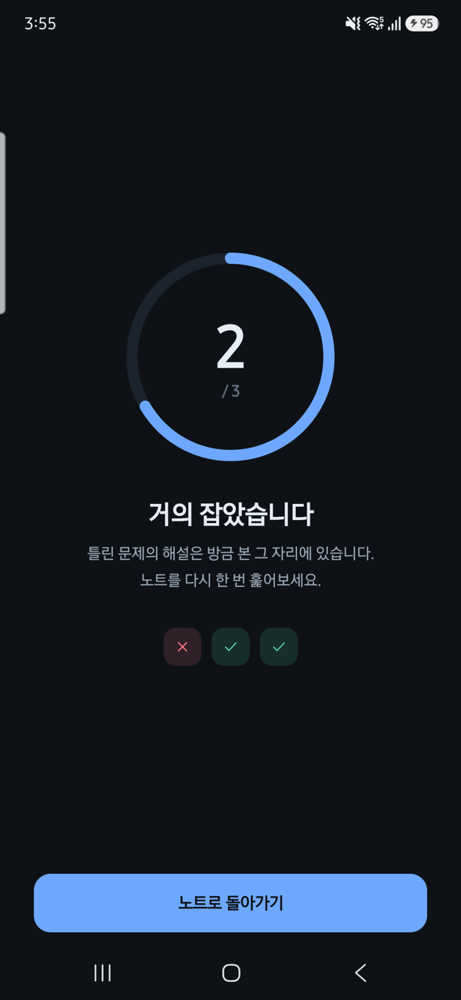
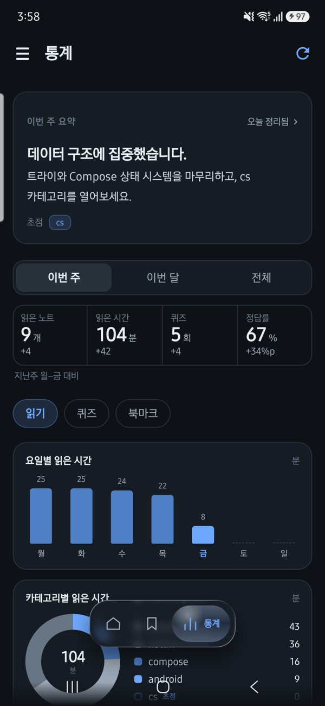
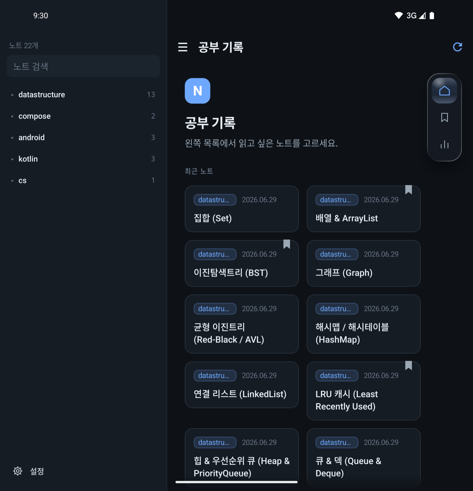
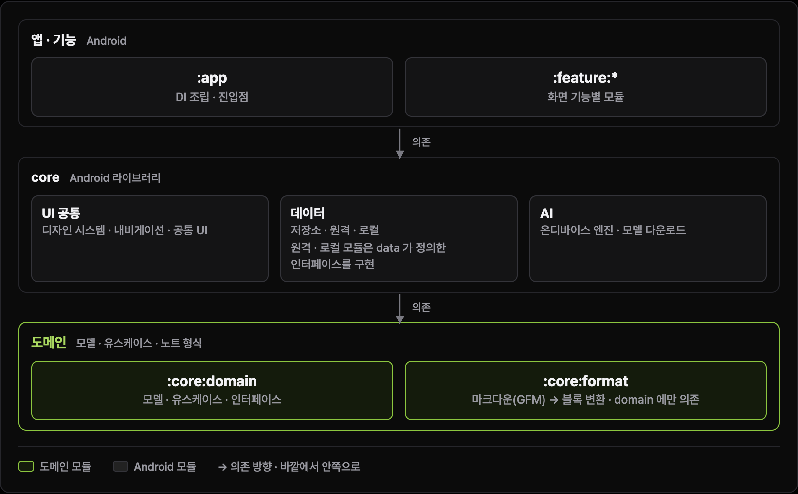

  

# MyNote

GitHub 저장소에 올려 둔 마크다운 학습 노트를 받아 읽는 안드로이드 앱입니다.
읽은 노트로 기기 안에서 4지선다 퀴즈를 만들어 풀고, 무엇을 얼마나 공부했는지 통계로 봅니다.
노트는 저장소에서 쓰고 앱은 읽기만 합니다.

## 주요 기능

- **노트 저장소 연결** — GitHub 저장소 주소를 붙여 넣으면 노트를 불러옵니다. 비공개 저장소는 읽기 전용 토큰으로 연결합니다. 저장소에서 바뀐 노트만 다시 받습니다.
- **마크다운 노트 읽기** — 제목 · 문단 · 목록 · 코드 · 인용 · 표 같은 GFM 문법을 읽기 좋은 화면으로 그립니다. 받은 노트는 기기에 남아 오프라인에서도 읽힙니다.
- **북마크** — 다시 볼 노트를 모아 두고, 가장 최근에 모은 노트를 크게 보여 줍니다.
- **온디바이스 퀴즈** — 노트 본문으로 4지선다 문제를 만듭니다. 모델(Gemma 4 E2B)이 기기에서 돌아 노트가 밖으로 나가지 않습니다.
- **학습 통계** — 읽은 노트 · 읽은 시간 · 퀴즈 정답률을 주 · 달 단위로 보여 주고, 한 주의 공부를 한 줄로 요약합니다.
- **폴더블 · 큰 화면** — 넓은 창에서는 목록과 본문을 나란히 놓고, 접고 펴도 읽던 자리가 남습니다.

## 화면

  
  
  
  

  

## 시작하기

1. **노트 저장소를 만듭니다.** 노트 하나는 `notes/<그룹>/<id>.md` 파일 하나이고, 앞머리(`title` · `date`)와 마크다운 본문으로 씁니다.
   예시 노트와 노트 목록 작업이 들어 있는 템플릿 저장소의 원본이 이 레포의 [`public-repos/notes-template/`](public-repos/notes-template/) 에 있습니다(아직 템플릿 저장소로 공개하지 않았습니다).
2. **앱에 주소를 붙입니다.** 처음 켜면 나오는 연결 화면의 `저장소 주소` 칸에 저장소 주소를 붙여 넣고 `연결` 을 누릅니다. 비공개 저장소라면 이어서 읽기 전용 토큰을 넣습니다.
3. **퀴즈 모델은 앱 안에서 받습니다.** 모델(2.6GB)은 앱에 들어 있지 않습니다. 노트 끝의 퀴즈 카드나 설정에서 받기를 누르면 Wi-Fi 에 연결됐을 때 받기 시작하고, 받는 동안 앱을 계속 쓸 수 있습니다.

Android 12L(API 32) 이상에서 돌아갑니다. 빌드는 `./gradlew :app:installDebug` 입니다.

## 구조

  

모듈은 바깥에서 안쪽으로만 의존합니다. `:app` 은 Hilt 로 구현을 묶고 여러 기능을 한 화면에 엮는 셸을 둡니다.
화면은 기능마다 모듈 하나 — `:feature:notes`(홈 · 북마크 · 리더) · `:feature:connect`(저장소 연결) · `:feature:settings`(설정) ·
`:feature:quiz`(퀴즈) · `:feature:stats`(통계) — 이고 기능끼리는 서로를 모릅니다. 둘 이상의 기능이 쓰는 화면 조각은 `:core:ui`,
화면 이동 계약은 `:core:navigation`, 디자인은 `:core:design-system` 이 맡습니다. 데이터는 `:core:data` 가 원격(`:core:network`)과
로컬(`:core:database`)을 맞추고, 노트 원문을 블록으로 바꾸는 일은 `:core:format`, 온디바이스 모델은 `:core:ai` 가 합니다.
모델 · 유스케이스 · 인터페이스는 순수 Kotlin 모듈 `:core:domain` 이 소유합니다.

## 기술 스택

Kotlin · Jetpack Compose · Navigation 3 · Hilt · Room 3 · DataStore · Retrofit · OkHttp · WorkManager · LiteRT-LM · JetBrains Markdown · kotlinx.serialization · Gradle 컨벤션 플러그인과 버전 카탈로그.

## 개발자용 문서

에이전트와 개발자를 위한 안내는 [`AGENTS.md`](AGENTS.md)(모듈마다 따로 있습니다), 디자인 기준은 [`DESIGN.md`](DESIGN.md), 기능 문서는 [`docs/`](docs/) 에 있습니다.
