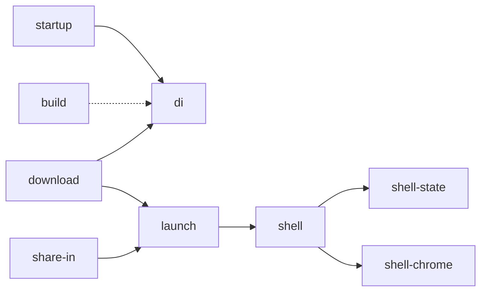

## Overview
`:app` is the composition root and the shell. It completes the Hilt graph, turns build values into injectable seeds, owns the two activities and the Android manifest, and draws the one screen that binds every feature: start branch, window-class decision, scaffold, drawer or fixed panel, floating navigation, model pill, `NavDisplay`, overlay slots and the back order.
It holds no feature screen and no feature ViewModel; those live in the six `:feature:*` modules, and pieces shared by two features live in `:core:ui`. Feature modules do not know the shell: they expose registration functions and slots, and the shell calls them.
The system touch points that need a manifest component or the process lifecycle also live here: notification intents, the share trampoline, the splash exit and the title-font gate.
Several things here stay alive only through one injected field in `MyNoteApplication`; deleting such a field compiles and runs but silently drops the behaviour (see `startup`).
## Structure
- `startup` is started from `MyNoteApplication.onCreate` and uses the `di` application scope; `download` adds the model notice observer to the same start and supplies the notification intents that open `launch`.
- `launch` hosts the shell (`shell`) in a Compose root and consumes the settings deep link that `download` notifications and `share-in` produce; `share-in` hands over through the inbox in `:core:ui`, not through intent extras.
- `shell-state` supplies the state and intents; `shell` composes the start branch, scaffold and back handlers in one file so the order stays fixed; `shell-chrome` is read by `shell` as overlays that sit outside the backdrop box.
- `di` binds the seeds and the implementations only this module can name; `build` holds build values, manifest, backup rules and the instrumented test harnesses (including the statistics evaluation).

