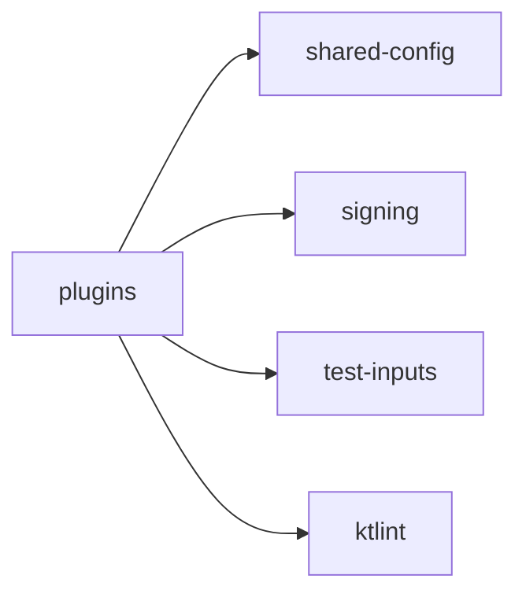

## Overview
Build logic is a separate composite build holding one Gradle project, `convention`, that registers the nine `hancenote.*` convention plugins. A module's `build.gradle.kts` names one plugin and its namespace; SDK levels, Java 17, desugaring, ktlint, Compose, Hilt and the feature wiring come from the plugin.
It owns how modules are configured, not what they contain. Versions and coordinates are not here: they live in the root version catalog, which this build reads from the same file.
It has no Kotlin tests of its own; the plugins are exercised by every module build, and module-boundary rules that read this source are tested in the Python suite.
## Structure
- `plugins` is the entry: each plugin class applies the others it builds on and calls the helpers.
- `shared-config` is called by the application and library plugins (Android and Kotlin settings) and by the Compose plugins; the JVM plugin calls only its Kotlin part.
- `signing` is called by the application plugin only; `test-inputs` by the library and JVM library plugins.
- `ktlint` is applied by the application, library and JVM library plugins, never by a module directly.
- The feature plugin is the one place that names other project modules, as strings, because typesafe project accessors do not exist inside a plugin.

