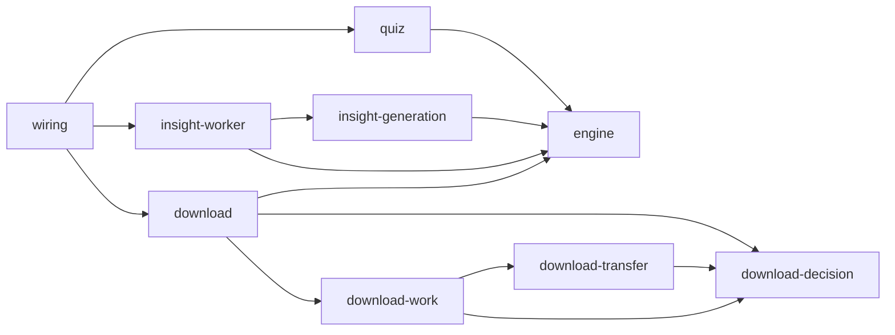

## Overview
`ai` runs the language model on the device and downloads it. It owns the one LiteRT-LM engine that the quiz and the statistics worker share, quiz generation and the repair of the model's answer, the daily statistics worker with the writing and guarding of weekly summaries and wrong-answer patterns, and the model download (decision, transfer, work, notifications).
It implements contracts that `domain` owns (`QuizGenerator`, `QuizModelSource`, `InsightScheduler`) and has no screen. It does not cut the note text (the quiz use case in `domain` does), compute statistics or decide what the worker should write (`domain` stats), store results (`database`), or show the model card and quiz screens (`settings`, `quiz`, `ui`). Quiz timeouts and the quiz screen's failure kinds are the caller's.
## Structure
- `engine` holds the single engine and the only way to use it; `quiz` and `insight-generation` borrow it through `engine.use` (quiz) or through the worker's `tryUse`, and send every generation through the cancellable call.
- `quiz` turns a note into questions and repairs the reply; `insight-generation` turns a digest or wrong answers into one JSON object and rejects bad output before any screen sees it.
- `insight-worker` plans, calls `insight-generation`, saves through the `domain` repositories and is scheduled by `StudyInsightWork`; it also reads the download work by name to stay out of its way.
- `download` composes the model status for `domain` from the work state and the files; `download-decision` holds its pure rules, `download-transfer` fetches and verifies the file, `download-work` runs it in a foreground worker and keeps one notification.
- `wiring` binds the three contracts and the download HTTP client; `:app` puts the module in the graph and supplies the notification tap intents.
- Outside facts it depends on: the two native-library lines in the `:app` manifest decide GPU use; `:app` instrumented evaluation tests drive the real model.

