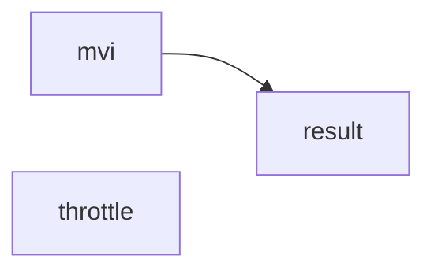

## Overview
Common holds three thin pieces that the outermost layers share: the base class every screen ViewModel extends, a throttler with injectable clocks, and a `Result` wrapper that does not swallow coroutine cancellation.
It is a leaf: no other project module and no Compose. It is an Android library, not pure JVM, only because the default monotonic clock reads the Android system clock. Anything screen-related and shared goes to the design system, not here.
## Structure
- Every feature ViewModel and the app shell's ViewModel extend `mvi`; its failure boundary uses `result`.
- `throttle` is used by the navigator (`navigation:navigator`), by the design system's throttled click helper, by the model download worker for progress updates, and, through the wall clock, by ViewModels that stamp stored times.
- `result` is called by sync, quiz generation and the device-note and connection repositories, and by `mvi` itself.
- Feature modules get this module from the feature convention; the other users declare it themselves.

