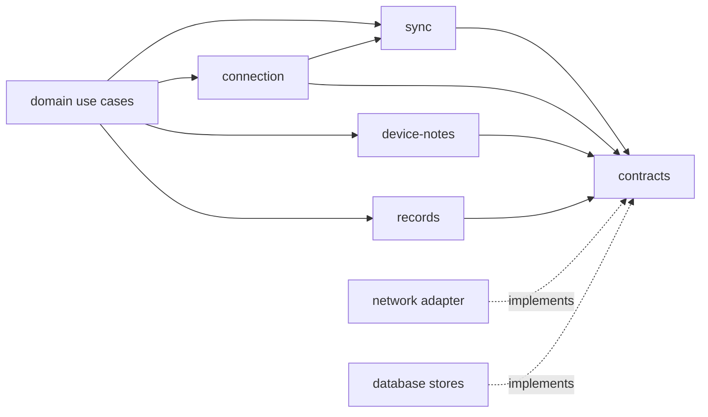

## Overview
Data implements the domain repositories and owns the data-source interfaces that the outer modules implement: `network` implements the note-source adapter, `database` implements the local notes source and every store. It orchestrates repository-note sync (reconcile per source), the repository connection lifecycle (begin, first sync, confirm, discard, disconnect, start recovery) and the write path of device notes.
It implements neither remote nor local storage, knows no Room, Retrofit or DataStore type, and does not parse note bodies itself: every original goes through `NoteFormat` of `format` together with its path. Sorting of notes, sync triggers and every screen are elsewhere.

## Structure
- `contracts` is the boundary: interfaces (`NoteSourceAdapter`, `LocalNotesDataSource`, the stores) and boundary types (`CachedNote`, `SourceEntry`, `IndexNoteDto`). `network` and `database` depend on this module to implement them; this module never sees them at compile time.
- `sync` (`NotesRepositoryImpl` + `SourceReconciler`) writes repository notes; `connection` reuses the same reconciler for a connection attempt's first sync, on an in-memory source.
- `connection` holds `ConnectionRecovery`, which `sync`, every connection entry and the app's token sync wait for once per process before doing anything.
- `device-notes` writes the device source (`local`) through the same local notes source; `sync` re-derives its rows like any other.
- `records` are thin delegations from domain repositories to stores (bookmarks, study log, insights, settings, token).
- `data` binds all repositories in Hilt and provides the one shared `Json`; `app` completes the graph with `network` and `database`.

