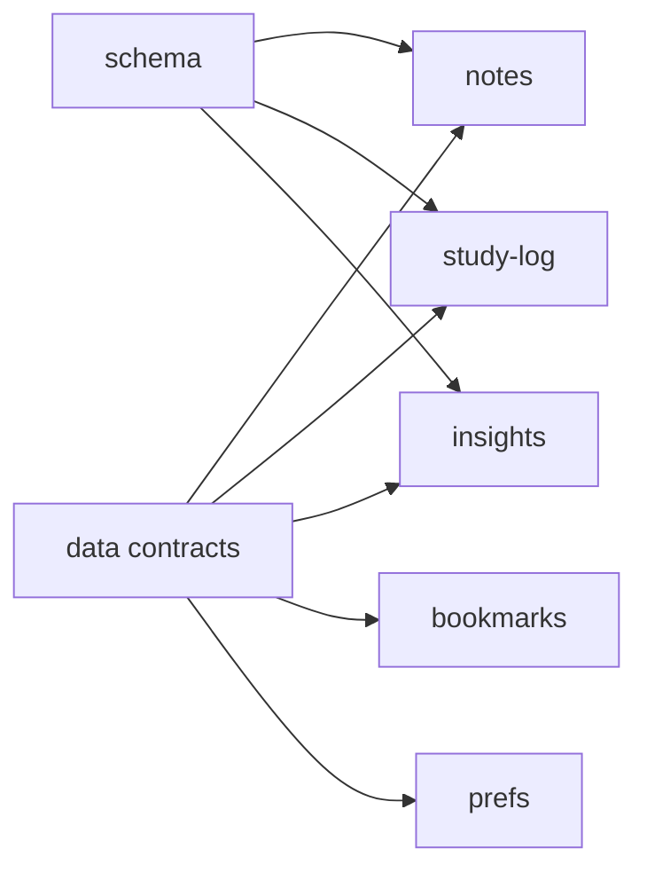

## Overview
Owns every on-device store behind the `:core:data` contracts: the Room 3 database `notes.db` (notes of every source, study records, weekly summaries, quiz patterns) and the DataStore files (settings, token, connection state, bookmarks, worker status). It implements those contracts and keeps Room and DataStore types inside the module.
The notes table is the single source of truth for what screens list. It holds the only copy of device notes, so the database is not a disposable cache: it is never rebuilt destructively.
It does not decide what to store or when: sync rules, re-parse, connect flows and statistics maths live in `data`, `domain` and the feature modules. It does not parse note text and does not know the quiz model.
## Structure
- `notes` is the notes table plus its DAO and the `LocalNotesDataSource` implementation that `data` calls for sync, re-parse and device-note writes.
- `schema` declares `NotesDatabase` (version 5), the one hand-written migration and the Hilt modules that bind every store in this module.
- `study-log` and `insights` live in the same database file as `notes` but are unrelated to it; `insights` also owns the worker-status DataStore file.
- `bookmarks` and `prefs` are DataStore files with no link to Room; bookmark keys are note keys, so they follow the key scheme `notes` stores.
- Callers see only the `:core:data` interfaces; every entity, DAO and row type is internal.

