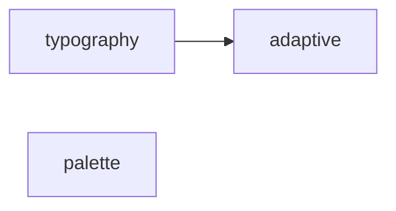

## Overview
Design foundation is the house of the design tokens: the single dark colour palette, the brand lamp colours, corner radii, the 19 text styles, and the window-size classes with the responsive tokens derived from them. It is the only place where colour literals are allowed; everything else reads these names.
It holds values and pure functions only, with no composables, no composition locals, no resources. The theme entry point that puts these values into the composition lives in the design system. The values themselves are listed in the root `DESIGN.md`; the specs here state the rules and do not repeat the tables.
## Structure
- `palette`, `typography` and `adaptive` do not depend on each other except that `typography` takes the height class from `adaptive`.
- The design system's theme calls `adaptive` and `typography` once per window and holds the results; screens read tokens from the theme. The app shell is the one place that measures the window and picks the classes.
- It has no project dependencies, and the design system depends on it, never the other way. The navigation module does not depend on it either.

