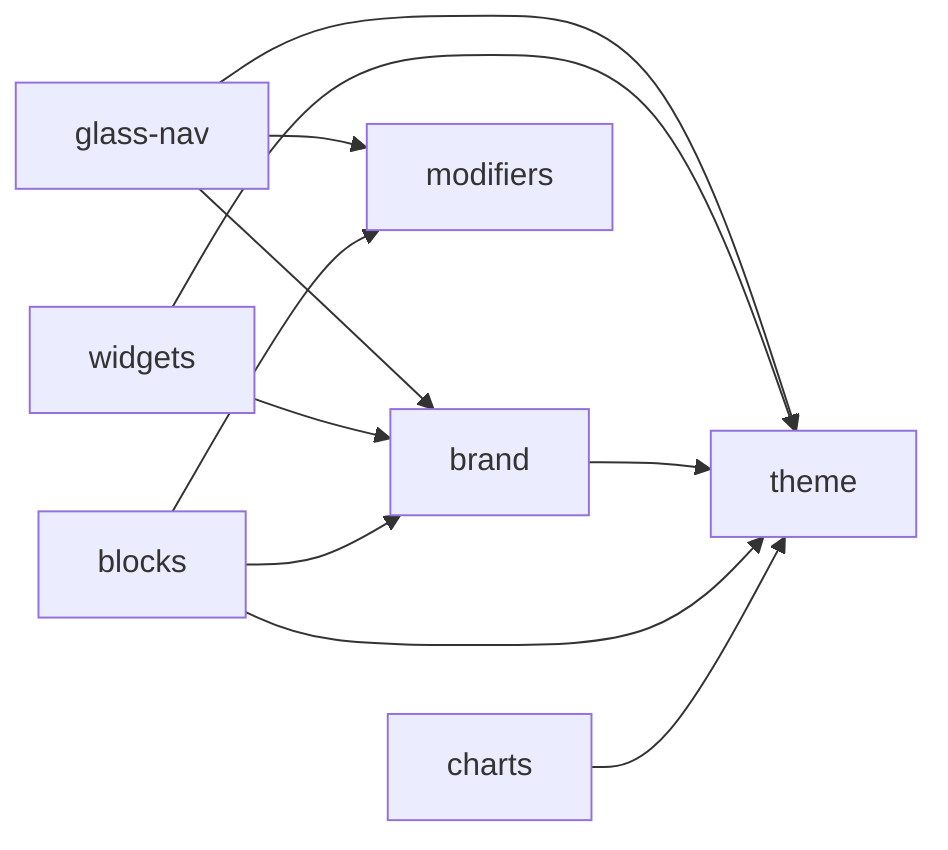

## Overview
The design system is the pure UI layer every screen draws with: the theme wiring, the liquid-glass surface and floating navigation, reusable widgets and modifiers, the hero and icons, the note body renderer and the statistics charts. It reads tokens (colours, text styles, adaptive sizes) and does not own them.
It knows nothing of data, domain, navigation or MVI: widgets take plain values and callbacks, note content arrives as its own UI model, shared-element transitions arrive as `Modifier` slots. Values, rules per component and the design to code difference table live in the root `DESIGN.md`; the specs here state behaviour and traps only.
It does not decide when to show things (window class, scroll thresholds, which screen has a nav, what a chart measures); callers do.
## Structure
- `theme` supplies the colours, adaptive tokens, text styles and font scale that every other unit reads, and `rememberReduceMotion` for the units that animate. There is no Material theme.
- `font` decides the title font once per process; the app calls it before building its first screen and hands the result to `theme`.
- `glass-nav` holds the only place that draws the backdrop effect (`GlassSurface`); the bar, rail, scroll-to-top button and status pill are built on it. The app shell owns the `layerBackdrop` box those surfaces sample.
- `modifiers` is the shared motion and press feedback layer; `glass-nav` and `blocks` use `PressIndication`, and `blocks` uses the horizontal scroll fade for tables.
- `widgets` is the catch-all for loose files of `component/`: cards, rows, chips, field, snackbar and the source marks.
- `brand` draws the home hero, the logo vectors and the icon set; `widgets`, `glass-nav` and `blocks` take their icons from it.
- `blocks` renders `NoteContentBlock` lists; feature mappers translate domain blocks into this model one way.
- `charts` are five Canvas charts that draw from a progress function the caller creates with `rememberChartProgress`.

