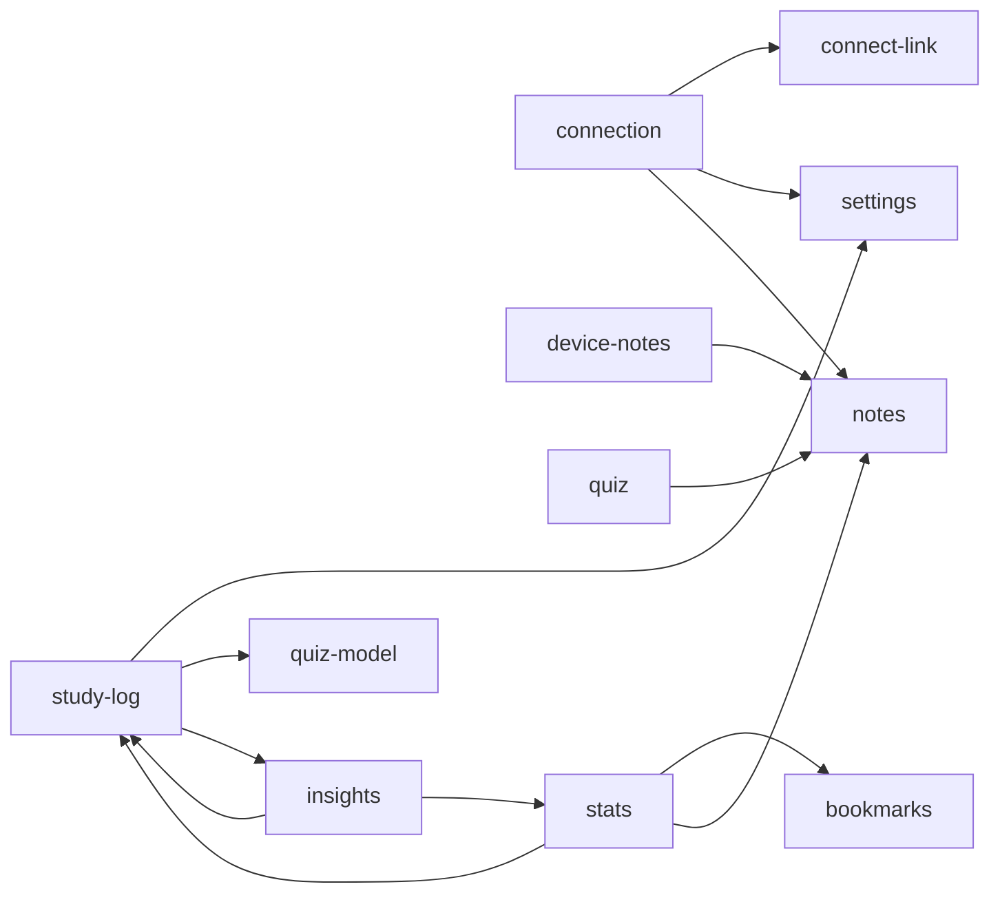

## Overview
The innermost module: plain Kotlin data models, the repository and source interfaces that outer modules implement, one use case per action, and the pure rules for reading sessions, statistics, weekly digests and link parsing. It depends on no project module and only on coroutines and `javax.inject`, so Android types, serialization annotations, Compose stability annotations and string resources cannot appear here; the build enforces it.
It does not own storage, network, the on-device model, Markdown or JSON parsing, any screen text, or time-outs and thread choice. Failure types carry English diagnostic messages only; screens branch on the type. Wiring (Hilt bindings) lives in `data`, `network`, `ai` and `app`.
The top-level package mixes use cases of many features in one folder, so units are lists of files grouped by what they serve, not folders.
## Structure
- `notes` holds the note model every other unit keys on (note key, blocks, limits, sync result and failure kinds) and the cached-tree and sync pass-throughs.
- `excerpt` derives the first sentence from blocks (the UI mapper calls it for cards); `bookmarks` is the bookmark model and its three commands.
- `device-notes` holds the editor rules, the import rules and the write interface for notes whose original lives in the app; it calls rules implemented in `format` through an interface.
- `connect-link` turns a pasted address into a repository and candidate list locations with no network; `connection` verifies it, runs the connect, change and disconnect flows, and decides when a sync runs; `settings` holds the saved and the applied token and the two stored settings.
- `quiz` builds the plain text of a note for the model and calls the generator; `quiz-model` is the model's install state and its four commands.
- `study-log` records reading sessions, quiz attempts and bookmark events behind one on/off switch and prunes them; `stats` computes the numbers and lists of the statistics screen; `insights` decides what the daily worker builds, builds the digest numbers the model may quote and lists past weeks.

