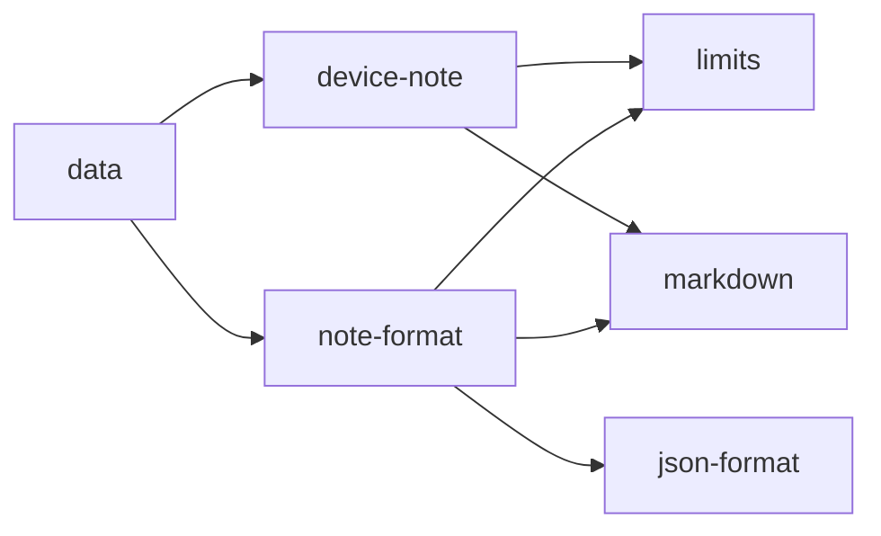

## Overview
Turns one note original into blocks: it picks the format from the path, checks limits, converts Markdown (JetBrains markdown engine, GFM) or reads JSON format 1, and writes and reads the block cache JSON that sits in the notes table. It also holds the text rules for device notes that share Markdown's front-matter and size code.
It is pure JVM with no Android dependency; only `data` uses it. The engine and its types stay inside the module, and every DTO is internal.
It does not fetch, store or draw notes: caching rows is `database`, deciding when to re-parse is `data`, drawing blocks is the design system and the notes feature. The block model and the limit values belong to `domain`.
## Structure
- `note-format` is the only entry. It picks the format by path, asks `limits` before the engine runs, calls `markdown` or `json-format`, and turns the result into the cache JSON and the first sentence.
- `markdown` splits off front matter and converts the engine tree into blocks; it counts block depth and table cells while walking and reports a whole-note over-limit box.
- `limits` is the screening done on the raw text before any engine call: size and container nesting.
- `json-format` reads the frozen format-1 wire shape into the cache shape; cache shapes may grow, wire shapes may not.
- `device-note` reuses the front-matter split and the byte count to define device-note size bounds, import rules and the stored shape.

