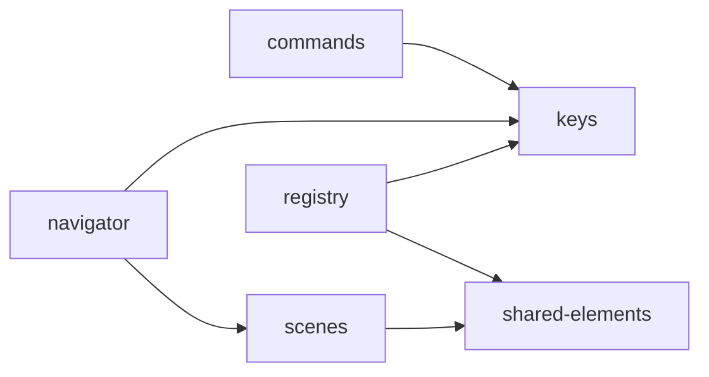

## Overview
Navigation is the contract module for moving between screens: the destination keys, the one owner of the back stack, the commands that compute new stacks, the scene strategy and transition motion, the registration frame for destinations and the shared-element wiring.
Keys live here so that feature modules, which must not know each other, can still go to each other's screens, and one shell can put all of them on one stack. The module imports no design system, domain, data, Material or Hilt; scenes take their panel, header and sizes as slots from the app shell.
It does not draw any screen and holds no theme. It depends only on the Navigation 3 libraries, Compose foundation, serialization, coroutines and `common` (for the throttler).
## Structure
- `keys` is the vocabulary; `navigator` holds the stack of keys and `commands` compute the next stack from the current one, so callers send one command per user action.
- `scenes` draws the stack: one display, with the strategy choosing between a stacked single pane and a two-pane list-detail scene; `registry` and `shared-elements` are what a feature uses to register a screen and take part in shared transitions.
- The navigator's throttle window comes from the scene motion numbers, so a longer transition lengthens the window with it.
- Callers: the app shell (navigator, display, strategy, provider), every feature module (registrations, commands, keys, shared-element modifiers) and the feature ViewModels that dispatch.

