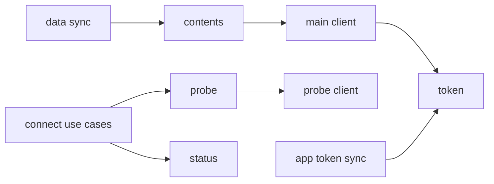

## Overview
Network talks to the GitHub REST API, read-only: it implements the GitHub note-source adapter of `data` (list file and note originals), the connection check behind the connect flow, the in-memory applied token with its auth header, and a snapshot of the device's network state.
Every type it hands out belongs to `data` or `domain`; Retrofit and OkHttp types stay inside. It does not compare revisions, reconcile, parse note bodies, store tokens or show anything; it never writes to GitHub.

## Structure
- `contents` is the sync path: `data:sync` calls the adapter (bound into the adapter set by kind GitHub); requests go through the main client, which carries `token`'s auth header.
- `probe` is the connect path: domain connect use cases call it with an explicit candidate token on a separate client without the auth header.
- `token` is filled by the app's token sync from the stored token and read by the auth header on every request; its applied stream tells the notes screen when to sync again.
- `status` answers "offline?" for the connect check before any request.
- `network` builds both clients, the Retrofit instances and the Hilt bindings, injecting the shared `Json` from `data`.

