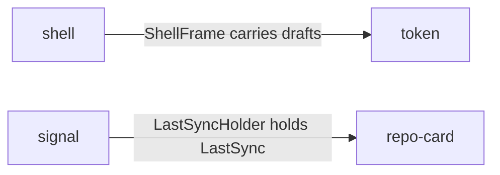

## Overview
`ui` is where anything two or more feature modules share lives, because feature modules do not depend on each other: screen pieces that know feature meaning (model status, repository card, token input), the contract between the shell and registered screens, the signals features send each other, snackbar wording, and the mapper from domain note blocks to reader blocks.
It deliberately does not own navigation commands (tab kinds, open-reader, destination keys: `navigation`), the design system's meaning-free components (`design-system`), or the shell itself (`app`). It knows no feature module, data layer or model implementation, and uses no Hilt plugin (only `javax.inject` annotations; `app` builds the graph).
Strings are prefixed `ui_`; a string is here when this module's code uses it or two or more modules use it.
## Structure
- `shell` defines what a registered screen receives from the shell (`ShellFrame`) and owns the scroll-state holder and the top bar; `app` implements the frame and every feature's registration file consumes it.
- `signal` and `notices` carry what features say to each other and to the user; every feature ViewModel and the shell ViewModel read them, `app` binds the Android implementations.
- `model-status`, `repo-card` and `token` turn domain state into card, pill, badge and field state; `settings`, `notes`, `quiz`, `connect` and the shell draw them.
- `parts` holds the buttons, boxes, fields and dialog frame used by connect, settings, notes and editor; `bookmark-time` is a label formatter used by notes and stats.
- `mapper` is used by the reader (`notes`) and the editor preview (`editor`), so both draw a note the same way.

