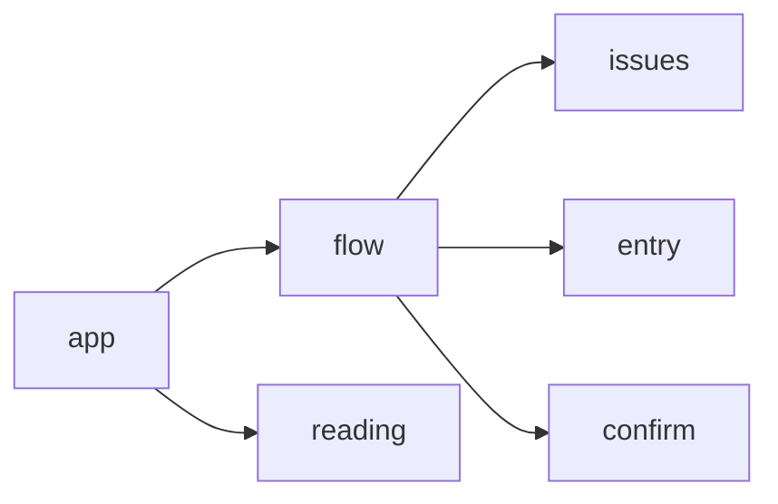

## Overview
`connect` owns the screen where a person pastes a GitHub repository or list address, the check that follows, the token request when the repository is not visible, the first sync, and the two confirm dialogs (change, take over). It owns the pure decisions behind them: what a pasted link looks like, which failure becomes which screen state, when the template entry shows.
It does not own the check, the first sync, the confirm transaction or disconnecting (use cases in `domain`, implemented in `data`), the home connect band and hint (`notes`), the settings repository card, disconnect dialog and token editor (`settings`), or which screen shows at start and back order (`app`).
It is not a start result: the screen opens only as the stacked destination `Connect` from home's first-run button, the home hint and settings `바꾸기`.
## Structure
- `flow` is the screen, its Activity-scoped ViewModel and the registration function `connectDestinations`; it asks `issues` how to read a pasted link and a failure, shows `entry` and, when a replacement is pending, `confirm`.
- `issues` and the pure parts of `entry`, `confirm` and the back rule are plain functions over domain results; the ViewModel calls them and the screen only draws their answer.
- `reading` is a separate screen the shell shows while the start branch is undecided; it has no state and no input.
- Shared boxes, fields, buttons, dialog frame and browser opening come from `ui:parts`; token draft and failure kinds from `ui:token`; the top bar from `ui:shell`.
- Callers: `app` registers `connectDestinations` and calls `ConnectReadingScreen`; the ViewModel is obtained with the Activity as owner so the three entry points share one state.

