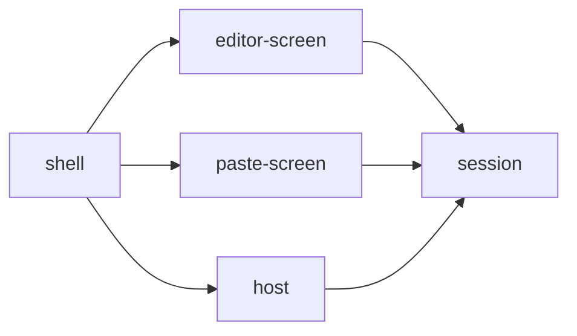

## Overview
Editor owns writing and bringing in device notes: the new-note and edit screen with a Markdown preview, the paste screen, the import sheet (open a file or paste), the leave and delete confirmations, and the one view model that holds the editing session, the pasted text and the text shared in from other apps.
It deliberately does not own saving rules, import rules or limits (use cases in `domain`, implemented in `data` and `format`), the shell frame and back order (the shell hides its own chrome and runs the back-press guard), the reader's edit and delete buttons, the share receiver activity (`app:share-in`), or note storage.
Device notes exist only through this module: nothing is created until Save, and unsaved text is never written to disk or to saved state.

## Structure
- `session` is the single view model, kept with the Activity as owner. It follows the editor key on the navigator stack: a new key opens a session, a vanished key drops it.
- `editor-screen` and `paste-screen` are two stack destinations, registered together; both draw their own top bar and take the whole window area the shell gives them.
- `host` is composed by the shell above the start branch at all times: it holds the system file picker launcher and the three dialogs, so a picker result always has somewhere to return.
- Other modules reach this one in four ways: an editor key pushed on the stack (home's new note, the reader's edit), an import-request signal (home's Import), the shared-text inbox filled by the share receiver, and a delete request from the reader.
- The shell reads `guardsExit` from the state to decide whether back becomes a close request.

