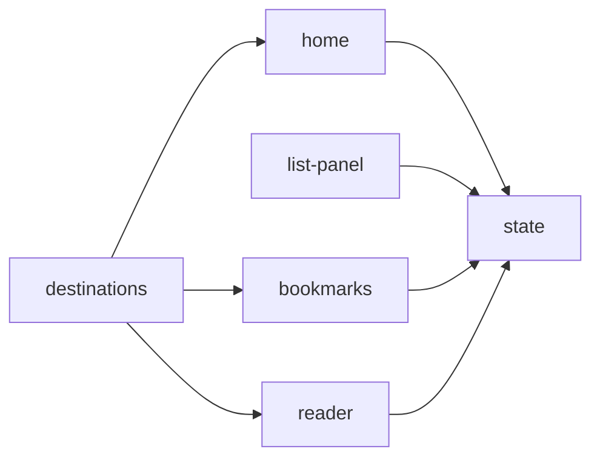

## Overview
Notes owns the screens a person reads notes on: the home grid with its empty states, the list panel with search, the reader body, and the Bookmarks tab. It also holds the one view model that lists notes, filters them, subscribes to sync, keeps bookmarks and feeds the reading record.
It deliberately does not own the shell (scaffold, drawer or fixed-pane frame, back order, reader top bar with the bookmark toggle, edit and delete buttons, snackbar host, start decision), the reader-end quiz card (a slot that the shell fills), the connect screens, settings, statistics or the editor.
Navigation keys, scene strategy and shared-element wiring live in `navigation`; reusable widgets (note card, rows, chips, hero, note renderer) live in `design-system`; screen pieces shared with other features live in `ui`.

## Structure
- `destinations` registers Home, Bookmarks and Reader for the shell; each destination reads the notes state inside its own lambda, so other features' state changes do not redraw it.
- `state` is the only owner of note data: it builds the state that `home`, `list-panel`, `reader` and `bookmarks` draw, and takes their intents.
- `home` and `bookmarks` are tab roots; `reader` opens from a card, a panel row or a bookmark; `list-panel` is shown by the shell as a drawer (Compact) or a fixed pane (Medium and up).
- Intents that leave this module go out as navigator commands or `ui` signals: new note → editor key, Import → a signal the editor's import sheet receives, settings and connect → navigator.
- The shell supplies scroll states, content padding, the two-column decision and the reader-end slot; this module reads them and does not decide them.

