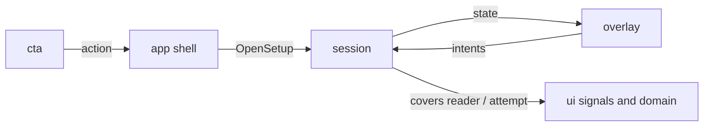

## Overview
Owns the quiz a reader takes at the end of a note: the card that starts it, the setup dialog, the generating, solving, result and failure screens that cover the reader, and the view model that holds the quiz in memory, grades answers, runs the auto-advance timer and the quit undo, and records a finished attempt for statistics.
The quiz is an overlay, not a back-stack destination: it has no destination key and no registration file.
It does not generate questions (the on-device model and prompt live in `ai`, the use case in `domain`), does not download the model (`ai`, the settings model card in `settings`), and does not decide where a card tap leads, where the overlay sits in the back order, or which notes are readable (`app` shell and `notes`).
## Structure
- `session` is `QuizViewModel` with its state (`QuizOverlayState`, `QuizUiState`) and intents; it is obtained with the Activity as owner by the `app` shell and talks to other features only through `ui` signals (setup request, close, quiz covers reader).
- `overlay` draws whatever `session` holds over the reader: the setup dialog over a scrim, or one full-cover screen per state; every button sends a `QuizIntent` back to `session`.
- `cta` is the card at the end of the reader; the `app` shell puts it into the notes reader-end slot and routes its action (setup through `session`, download through `settings`, or a confirm dialog).

