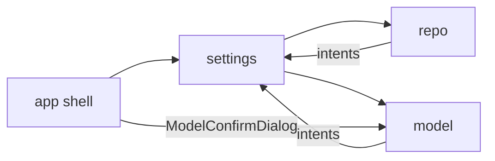

## Overview
Owns the Settings destination and its view model: the reading text size, the study-log switch and its clearing, the quiz model card with its download actions and confirm dialogs, and the notes repository card with the access-token editor, repository change entry and disconnect.
It keeps the raw token out of its state (only a masked form) and keeps the previous token for undo only in memory.
It does not store anything itself (stores and use cases are `domain` and the data modules), does not run the model download (`ai`), does not hold the token draft (the `ui` drafts holder kept by the `app` shell), and does not connect repositories (`connect`).
## Structure
- `settings` is `SettingsViewModel` (Activity-scoped), its state and intents, the registration `settingsDestinations` for the `Settings` key, and the screen frame that stacks the sections in the order reading, study log, quiz model, notes repository.
- `repo` draws the repository card and the token editor from the view model state and holds the pure token-edit transition table, the token mask, the link used for a token check and the check-failure mapping the view model applies.
- `model` draws the model card from the shared card decision in `ui` and the three glass confirm dialogs; `ModelConfirmDialog` is also called by the `app` shell for the reader-end quiz card.
- The `app` shell supplies whether system notifications are on, opens the notification settings, and receives the view model's snackbar notices.

