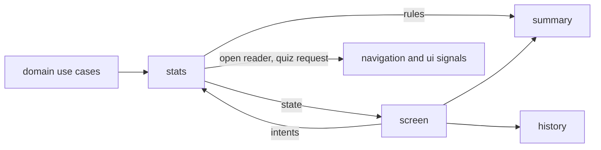

## Overview
Owns the Stats tab and the past-summaries screen: the period and section the person chose, the four headline numbers with their change, the reading, quiz and bookmark charts and lists, the weekly summary card and the wrong-answer pattern written by the on-device model, and the week-by-week history of summaries.
It shows figures; it does not compute them (period ranges, totals, lists and the history rows are `domain`), does not record study events (`notes`, `quiz`, the data modules), does not write summaries (the worker in `ai`), and does not draw the top bar, the floating navigation or the two-column decision (`app` shell).
## Structure
- `stats` is `StatsViewModel` (Activity owner) with its state, intents and the mapper from the domain figures to screen models; it attaches the aggregation, insights and history streams only while their screen is on top of the back stack.
- `screen` registers the `Stats` and `StatsHistory` destinations and draws the Stats tab in one or two columns from the `stats` state; list taps go back to `stats` as intents.
- `summary` decides whether the summary card and the pattern show and how old they read (pure rules used by `stats`) and draws the card inside the top item of `screen`.
- `history` draws the past-summaries list that the summary card's meta button opens.

